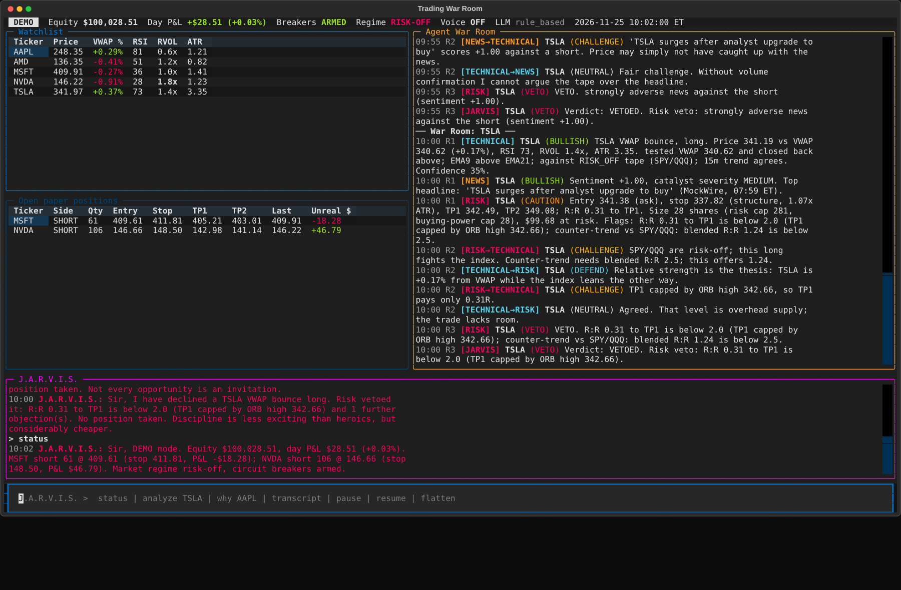

# Trading War Room

A multi-agent day-trading **analysis, risk-management and paper-trading** system. Three agents
(Technical, News, Risk) debate every setup in a live **Agent War Room**, Risk holds an absolute
veto, and a **J.A.R.V.I.S.**-style strategist briefs you in plain English (and, optionally, out
loud in a British voice).

> **Paper / advisory only.** There is no live order routing anywhere in this codebase, by
> design. `ALPACA_PAPER` must remain `true`; the app refuses to start otherwise. Nothing here is
> financial advice.



---

## Quick start

```bash
cd trading_war_room
python -m venv .venv && source .venv/bin/activate      # Python 3.11+
pip install -e ".[dev]"                                 # core + pytest (no API keys needed)

python main.py --smoke-test        # 3 headless cycles; prints SMOKE TEST PASSED, exit 0
python main.py --demo              # full TUI on synthetic data, zero keys
pytest -q                          # 233 tests, no network
```

`--demo` replays the most recent trading session (from 09:50 ET, 10x speed) on deterministic
synthetic data, so it works at 3 a.m. and on holidays. Quit with `Ctrl+Q` (or `Ctrl+C`).

### Optional extras

```bash
pip install -e ".[voice]"      # edge-tts + pygame (British voice), pyttsx3 offline fallback
pip install -e ".[llm]"        # anthropic / openai dialogue polish
pip install -e ".[yfinance]"   # Yahoo data (experimental)
pip install -e ".[news]"       # feedparser for RSS news
pip install -e ".[all]"        # everything
```

None of these are needed for `--demo` or `--smoke-test`; each is imported lazily and the system
degrades gracefully without it.

---

## Modes

| Command | What it does |
|---|---|
| `python main.py --demo` | Synthetic market + news, live War Room, paper fills, TUI |
| `python main.py --demo --voice` | Same, with spoken J.A.R.V.I.S. briefings |
| `python main.py --paper` | Real data providers from `config.yaml` + `.env`, paper broker, TUI. Standby outside market hours |
| `python main.py --replay 2025-01-15 --tickers AAPL,NVDA,TSLA` | Minute-by-minute replay through the *same* pipeline; prints trades, win rate, profit factor, max drawdown, total P&L |
| `python main.py --replay 2025-01-15 --replay-source mock` | Replay on the synthetic tape (no data needed) |
| `python main.py --smoke-test` | 3 headless cycles; exit 0 if a full debate + briefing succeed |
| `python main.py --check-providers` | Live checks of your configured providers and keys (bars, quotes, news, Fed/BLS calendar, halt feed, LLM) |

Add `--headless` to `--demo` / `--paper` to stream events to the console instead of the TUI.
Each mode uses its own database (`data/trades_demo.db`, `data/trades_paper.db`); replay and smoke
tests use an in-memory database, so they can never touch paper-trading state.

---

## J.A.R.V.I.S. commands

Type into the command bar at the bottom of the TUI (exact commands or natural phrasing):

| You type | J.A.R.V.I.S. does |
|---|---|
| `status` / "Status report" / "How are we doing?" | Equity, day P&L ($ and %), open positions, market regime, circuit breakers |
| `analyze TSLA` / "Look at NVDA" / `MSFT` | Convenes an on-demand War Room now (bypasses the cooldown) |
| `why AAPL` / "Why did you veto AAPL?" | Every veto reason from the latest transcript, plus the news desk's view |
| `transcript` / `transcript NVDA` | The full 3-round debate |
| `pause` / `resume` | Stops / restarts new entries (open positions stay managed) |
| `flatten` / "close everything" | Closes all paper positions at market |
| `help` | Command list |

`F2` = status, `F3` = transcript.

Example briefings:

> Sir, NVDA presents a VWAP bounce long. Risk approved: entry 146.46, stop 145.01, targets 149.36
> and 150.81. 170 shares, risking $246.50.

> Sir, I have declined an AAPL opening-range breakout long. Risk vetoed it: R:R 0.03 to TP1 is
> below 2.0 (TP1 capped by premarket high 220.53). No position taken. Patience, I am told, is also
> a position.

---

## How a decision is made

1. **Technical** scans 1m/5m/15m bars plus the SPY/QQQ regime and detects LONG and SHORT setups:
   ORB breakout/breakdown, VWAP bounce/rejection, EMA pullback, high-RVOL momentum. Only the last
   *completed* 5m bar is used. The same (ticker, direction) is not re-debated within 15 minutes.
2. **War Room, round 1 (pitch & evidence).** Technical pitches. News reports sentiment, catalysts and
   blackouts. Risk computes the entry, stop, targets, size and R:R.
3. **Round 2 (cross-examination).** Agents challenge concrete conflicts (news vs. tape, index
   headwind, targets capped by structure, wide stops, data or spread quality), and the challenged
   agent defends or concedes.
4. **Round 3 (binding verdict).** Risk re-checks against the *live* portfolio and votes APPROVE or
   VETO. J.A.R.V.I.S. issues `APPROVED`, `WATCHLIST` (approved but low confidence) or `VETOED`.
   Approval and paper execution happen under one portfolio lock, so two debates can never both take
   the last position slot.

### Risk rules (all in `config.yaml → risk`)

- **Levels.** LONG requires `stop < entry < TP1 < TP2`; SHORT requires the mirror. Entry is the
  ask (LONG) or bid (SHORT) plus slippage. The stop is the swing level plus a small ATR buffer, or
  1.5×ATR if the swing is farther away, and never tighter than 0.25×ATR.
- **Targets.** 2R and 3R, pulled in before the prior-day high/low, premarket high/low or ORB
  high/low. **R:R ≥ 2.0 is measured to TP1 after capping**, so the gate actually filters trades.
  Counter-trend trades (SPY/QQQ against you) also need a blended R:R ≥ 2.5.
- **Sizing.**
  `min(floor(equity×1% / |entry−stop|), floor(cash×25% / entry))`, then cut to fit the remaining
  daily-loss budget. Veto if the result is under 1 share.
- **Breakers:**
  - daily loss of 3% (realized + unrealized) halts entries for the day;
  - 3 consecutive losses trigger a 30-minute cooldown;
  - at most 3 open positions, and none on a ticker you already hold;
  - spread must be ≤ 0.15%;
  - data older than 120s is a veto;
  - no entries before 09:45 or after 15:30 ET;
  - news blackout from 15 minutes before to 15 minutes after a high-impact event or halt;
  - strongly adverse news is a veto;
  - optional PDT tracker.
- **Restarts can't reset any of this.** Today's P&L, the loss streak, the cooldown, PDT round trips
  and open positions are rebuilt from the SQLite ledger on every start.

### Paper broker

Slippage is 0.05% on market orders; commissions are configurable. When a 1m bar hits TP1, half the
position is sold and the stop moves to breakeven; TP2 closes the rest. Everything is flattened at
15:55 ET (12:55 on early-close days). Stops that gap through fill at the bar's open. If one bar
touches both the stop and a target, the stop is assumed to fill first, so results err on the side of
looking worse.

---

## Configuration

### `config.yaml`

Validated on startup: unknown keys and out-of-range values fail fast with a clear message. The main
sections are `app` (tickers, title, cadence), `demo`, `risk`, `technical`, `news`, `execution`,
`providers`, `voice`, `storage`, `replay`, `notifications` and `calendar`.

Set `app.user_title` to change how J.A.R.V.I.S. addresses you (default `"Sir"`).

### `.env` (copy from `.env.example`; every value is optional)

| Variable | Used for |
|---|---|
| `ALPACA_API_KEY`, `ALPACA_SECRET_KEY` | Alpaca market data and news (`providers.market_data: alpaca`, `providers.news: alpaca`), and historical replay |
| `ALPACA_PAPER` | Must be `true` |
| `FINNHUB_API_KEY` | Finnhub company news and earnings calendar (`providers.news: finnhub`) |
| `ANTHROPIC_API_KEY` / `OPENAI_API_KEY` | Optional dialogue polish (`providers.llm`). The LLM may only rephrase; any rewrite that changes a number is discarded. Falls back to rule-based text on errors or timeouts, and after `max_daily_llm_calls` |
| `DISCORD_WEBHOOK_URL` | Discord alerts (`notifications.discord_enabled: true`) |
| `TELEGRAM_BOT_TOKEN`, `TELEGRAM_CHAT_ID` | Telegram alerts (`notifications.telegram_enabled: true`) |

### Recommended `--paper` setup

```yaml
providers:
  market_data: alpaca     # real bid/ask and fresh bars; yfinance has neither (see --check-providers)
  news: alpaca            # or finnhub / rss
```

Run `python main.py --check-providers` once with your keys before trading.

### Macro calendar and halts

- **Calendar.** Blackouts use FOMC decision dates (built in and refreshed weekly from
  federalreserve.gov) and exact CPI/NFP/PPI/JOLTS dates from the BLS release schedule, cached in
  `data/macro_cache.json`. You can add your own events in `data/macro_events.yaml`:
  ```yaml
  - {name: Powell testimony, kind: OTHER, date: "2026-02-10", time_et: "10:00", severity: HIGH}
  ```
- **Halts.** These come from the Nasdaq Trader halt feed. If one ticker's bars stop while its peers
  keep updating, that is also treated as a probable halt.

### Replay data

Free sources don't keep old 1m bars, so supply your own as
`data/history/<YYYY-MM-DD>/<TICKER>.csv`:

```
timestamp,open,high,low,close,volume
2025-01-15T14:30:00Z,229.10,229.55,228.90,229.40,412000
```

Include SPY and QQQ, plus a few prior days for indicator warm-up. Replay looks for CSVs first, then
Alpaca (with keys), then yfinance (last ~29 days only). Historical bid/ask isn't available, so
quotes are synthesised with `replay.assumed_spread_pct`, and replay news is the macro calendar
only. The report states both assumptions.

---

## Development

```bash
pytest -q                       # full suite, ~35s, no network
python main.py --smoke-test     # end-to-end pipeline check
```

See [`CLAUDE.md`](CLAUDE.md) for architecture, invariants and conventions. In brief:
- trading logic gets time only from an injected `Clock`, never from `datetime.now()`;
- timestamps are UTC internally, converted to ET only for market hours;
- blocking I/O runs in `asyncio.to_thread`;
- the UI is a pure EventBus subscriber.

## Known limitations

- **Sentiment** comes from a lexicon scorer tested against a labelled headline set, not a language
  model. It still misreads sarcasm and context it has no knowledge of.
- **Same-bar ordering** inside a 1m bar can't be known from OHLC data; the conservative assumption
  understates results.
- **yfinance** has no bid/ask and lags; with the default `unknown_spread_policy: veto` it will veto
  almost everything. Use Alpaca for paper trading.
- **IEX quotes** on Alpaca's free tier are real, but thinner and wider than the full consolidated
  quote.
